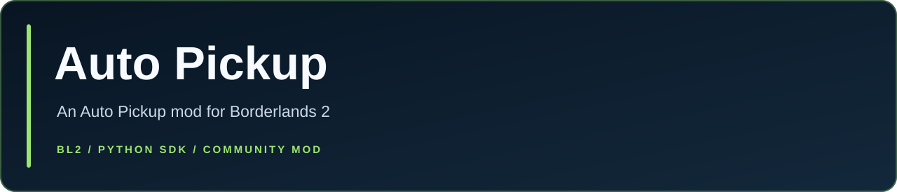

  <a href="#features">Features</a> ·
  <a href="#installation">Installation</a> ·
  <a href="#usage">Usage</a> ·
  <a href="#compatibility">Compatibility</a> ·
  <a href="#documentation">Documentation</a>

---

## Features

- Automatically collects eligible nearby ammo, currency, and consumables.
- Adjusts pickup range, frequency, and resource categories.
- Optionally collects equipment using category and rarity filters, **Off by default**.
- Provides an optional, rebindable quick toggle, with inventory-capacity and protected-item safeguards.

## Installation

1. Install [PythonSDK and Willow2 Mod Manager](https://bl-sdk.github.io/willow2-mod-db/).
2. Close Borderlands 2 and back up your existing `sdk_mods/AutoPickup/` folder and saved SDK settings.
3. Download the matching **Player ZIP** from the [Releases page](https://github.com/PeytonBlakeslee/AutoPickup/releases), then extract its `AutoPickup/` folder into `Borderlands 2/sdk_mods/`. Remove duplicate installations.
4. Confirm `sdk_mods/AutoPickup/__init__.py`, then launch the game and enable **Auto Pickup** in the SDK Mods menu.

**Download:** Use the matching Player ZIP on the [Releases page](https://github.com/PeytonBlakeslee/AutoPickup/releases). If no public download is listed, publication is still pending. GitHub's automatic source ZIP is not an installable Player package.

See the [user guide](docs/USER_GUIDE.md#install-update-and-rollback) for updates, rollback, and troubleshooting.

## Usage

- **Pickup Behavior:** Set pickup frequency and radius.
- **Equipment** and **Consumables & Currency:** Choose what to collect. Equipment pickup is Off by default.
- **Toggle Auto Pickup:** Optionally assign a key or compatible controller shortcut. The shortcut changes the current session; the SDK Mods **Enabled** option controls the saved startup preference.

See [settings and defaults](docs/USER_GUIDE.md#settings-and-defaults) and [quick-toggle setup](docs/USER_GUIDE.md#quick-toggle).

## Compatibility

**Windows Borderlands 2 single-player** is the primary Player target. Joining-client co-op and The Pre-Sequel are experimental or unverified; Proton/Wine is unverified. Native Linux BL2 is unsupported by this package.

**TPS caution:** Avoid using Auto Pickup during Grinder, chest, or scripted reward sequences. Some reward origins cannot be identified reliably. [Compatibility and safety details](docs/USER_GUIDE.md#compatibility-and-safety).

## Documentation

[User guide](docs/USER_GUIDE.md) · [Troubleshooting](docs/USER_GUIDE.md#troubleshooting) · [Report an issue](https://github.com/PeytonBlakeslee/AutoPickup/issues) · [MIT license](LICENSE) · [Third-party notices](THIRD_PARTY_NOTICES.md)

---

Other Borderlands 2 mods

- [No Warp Tunnel](https://github.com/PeytonBlakeslee/NoWarpTunnel)
- [Loot Recovery](https://github.com/PeytonBlakeslee/LootRecovery)
- [Controller Manager](https://github.com/PeytonBlakeslee/ControllerManager)
- [Controller Deadzone Control](https://github.com/PeytonBlakeslee/ControllerDeadzone)
- [OmniMovement](https://github.com/PeytonBlakeslee/OmniMovement)

